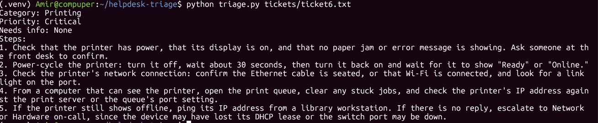

# Help Desk Ticket Triage

A command-line tool that reads an IT help desk ticket from a text file,
sends it to the Claude API, and returns a category, a priority, and the
first troubleshooting steps a Tier 1 technician should try.

I built this based on my experience as a Student IT Technician at the
University of Maryland Eastern Shore, where I triaged tickets from
students and faculty.

## How it works

1. Reads a ticket from the file given on the command line
2. Sends the ticket to Claude (Haiku 5.5) with a system prompt that
   defines fixed categories, priority levels, and an output format
3. Prints the triage result

The API key is read from an environment variable and never appears in
the code or the repository.

## Setup

Requires Python 3 and a Claude API key from the Claude Console.

```bash
git clone https://github.com/anazol755/helpdesk-triage.git
cd helpdesk-triage
python3 -m venv .venv
source .venv/bin/activate
pip install -r requirements.txt
export ANTHROPIC_API_KEY="your-key-here"
```

## Usage

```bash
python triage.py tickets/ticket6.txt
```

To run every test ticket and save the results:

```bash
for t in tickets/ticket*.txt; do echo "===== $t"; python triage.py "$t"; echo; done | tee results.txt
```

## Example

Input (`tickets/ticket6.txt`):

```
User: Dana in the library
Issue: The printer near the front desk says "offline" and nothing prints.
It was working this morning. Other people are having the same problem.
```



## Testing

I wrote 6 tickets based on real issues I handled, and recorded the
expected category and priority for each **before** running them
(`expected.txt`). Full outputs are in `results_v1.txt` and `results_v2.txt`.

| Ticket | Expected | v1 | v2 |
|---|---|---|---|
| 1. Computer lab offline | Network / Critical | ✅ | ✅ |
| 2. Locked account | Account/Access / High | ✅ | ✅ |
| 3. Projector before lecture | Hardware / Critical | ⚠️ High | ✅ |
| 4. SPSS install request | Software / Low | ✅ | ✅ |
| 5. Vague "can't get on Canvas" | Unclear: should ask | ⚠️ guessed | ✅ asked |
| 6. Shared printer offline | Printing / Critical | ❌ High | ✅ |

## What I fixed

**Problem:** In v1, a printer outage affecting several users was rated
High instead of Critical, and a vague ticket was confidently labeled
Network even though it could have been a login problem. In a real ticket
system, that label would route it to the wrong team.

**Fix:** I rewrote the Critical definition to include shared resources
not working for more than one user, and added a `Needs info` field so the
tool asks a clarifying question when a ticket is ambiguous.

**Regression check:** Rerunning all tickets showed the fix also raised
the projector ticket from High to Critical. I reviewed it and agreed:
a full class starting in 20 minutes is affected. So I updated my expected
result and documented why.

## What I learned

- Fixed rules (category lists, priority definitions) make AI output
  consistent enough to test
- A fix to one case can change others, so I rerun every test after
  each change
- The API can return more than one type of content block; my first
  version crashed by assuming the first block was always text
